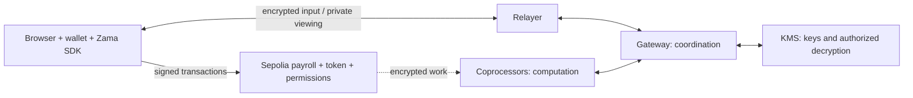

# Zama × Web3Bridge: Confidential Payroll

Build a payroll app that keeps salaries private. An employer sets a salary, adds a bonus, and pays an employee with confidential tokens. The employee can view their own salary and balance, then withdraw into public practice tokens.

The workshop follows **contracts → tests → frontend → payments**. You will learn encrypted inputs, calculations, access permissions, private viewing, and ERC-7984 token payments.

## Get started

Use **Node 22** (the version in each project's `.nvmrc`) and **npm 10+**. Replace `REPOSITORY_URL` with the published workshop URL:

```bash
git clone REPOSITORY_URL zama-web3bridge-workshop
cd zama-web3bridge-workshop/solution
nvm use
npm ci
npm run verify
npm run dev
```

Open [localhost:3000](http://localhost:3000). Local contract tests need no wallet, secrets, or testnet funds. To use the app, connect a browser wallet on **Sepolia** with Sepolia ETH for fees. Use a second wallet for the employee.

## Choose your starting point

| Folder                          | Use it for                                                          |
| ------------------------------- | ------------------------------------------------------------------- |
| [starter/](starter/README.md)   | Follow the lesson and fill in 14 numbered TODOs.                    |
| [solution/](solution/README.md) | Run or compare the complete app.                                    |
| `workshop-guide/`               | Architecture, instructor steps, and public deployment addresses.    |
| `resources/`                    | Official docs, a public payroll example, and the auditor challenge. |

**Starter and solution are independent projects.** Each has its own package, lockfile, dependencies, environment files, and checks. Install and run commands inside the project you choose. You can copy either folder and use it on its own.

To follow the lesson, start from the repository root:

```bash
cd starter
nvm use
npm ci
npm run verify
npm run dev -- --port 3001
```

Open [localhost:3001](http://localhost:3001). The starter compiles and runs three baseline tests; 23 exercise tests remain pending until their TODOs are completed. Run `npm run test:full` to include them. Both projects have the same file structure.

The [live guide](workshop-guide/LIVE_WORKSHOP.md) explains every TODO, its code, test command, and recovery step. The instructor can preview or apply a checkpoint from the repository root:

```bash
node workshop-guide/scripts/checkpoint.mjs 7
node workshop-guide/scripts/checkpoint.mjs 7 --apply
```

This fills TODOs 1–7 from the solution and backs up changed starter files. It preserves environment files. Use the complete solution for the live app.

## Connect to Sepolia

From inside your chosen project, use the existing workshop deployment:

```bash
cp ../workshop-guide/DEPLOYMENT.json frontend/deployment.json
npm run dev
```

Salary changes and payments require the configured employer wallet. Other wallets can use their own employee and token views. If you copied a project out of this repository, deploy your own contracts using the steps below.

To deploy, create `.env` from `.env.example` **only if it does not already exist**. Set `DEPLOYER_PRIVATE_KEY` and the matching `WORKSHOP_EMPLOYER_ADDRESS` there, then run from that project's root:

```bash
npm run compile
npm run check:sepolia
npm run deploy:sepolia
npm run check:sepolia
npm run dev
```

Deployment writes `frontend/deployment.json` automatically. Keep the project's `deployments/` folder: it lets deployment resume after a network or funding failure. Keep private keys in the ignored `.env` file, never in frontend variables.

`npm run test:sepolia` checks the full live flow. **It sends testnet transactions and funds a temporary employee with 0.006 Sepolia ETH**, then refunds unused fees apart from a small reserve. It is separate from local tests.

Sepolia needs no Zama API key. A browser wallet works without extra setup; WalletConnect is optional. Frontend server settings are listed in each project's `frontend/.env.example`.

## Use the app

1. As employer, enter an employee address, set salary `5000`, then add bonus `500`.
2. As employee, click **View my salary** and approve private viewing. Expect `5500`.
3. As employer, get practice tokens, enter `6000`, and shield to payroll. Approve and confirm both transactions.
4. Choose a payroll period, then pay the employee. Retry the same period if funding was insufficient; changing the period starts another payment.
5. As employee, view the confidential balance. Request an unshield amount, keep its request ID, then finalize when ready. Public tokens arrive after finalization.

Amounts use six decimal places. Practice tokens have no monetary value. The [live guide](workshop-guide/LIVE_WORKSHOP.md) includes a rehearsal checklist and common fixes.

## How it works



The browser encrypts salary inputs. Contracts store references to encrypted values and define who may use or view them. Coprocessors calculate with those values; the Gateway and KMS coordinate authorized decryption. See the [architecture guide](workshop-guide/ARCHITECTURE.md) for the complete picture.

**Confidential:** salary, bonus, confidential balances, payment amounts, and unpaid amounts. The employer and relevant employee have viewing permission.

**Public:** wallet and contract addresses, transaction sender, timing, events, payroll periods, encrypted-value references, and public token deposits and withdrawals. This app does not provide anonymity. A salary shown in the browser is visible to anyone watching that screen.

## Check your work

Run `npm run verify` inside either project. It compiles contracts, runs tests, checks lint and TypeScript, builds the frontend, and checks formatting for that project. Use `npm run format` to format changes. The solution has 26 tests covering encrypted input, permissions, bonus overflow, payments, retries, and withdrawal proofs.

The frontend uses Next.js, RainbowKit, Wagmi, Viem, and the current [Zama SDK](https://docs.zama.org/protocol/sdk/overview). Contracts use FHEVM and [OpenZeppelin Confidential Contracts](https://docs.openzeppelin.com/confidential-contracts). Each project's lockfile keeps its package versions together; use `npm ci`.

Continue with the [instructor guide](workshop-guide/LIVE_WORKSHOP.md) or [official resources and auditor challenge](resources/README.md).
