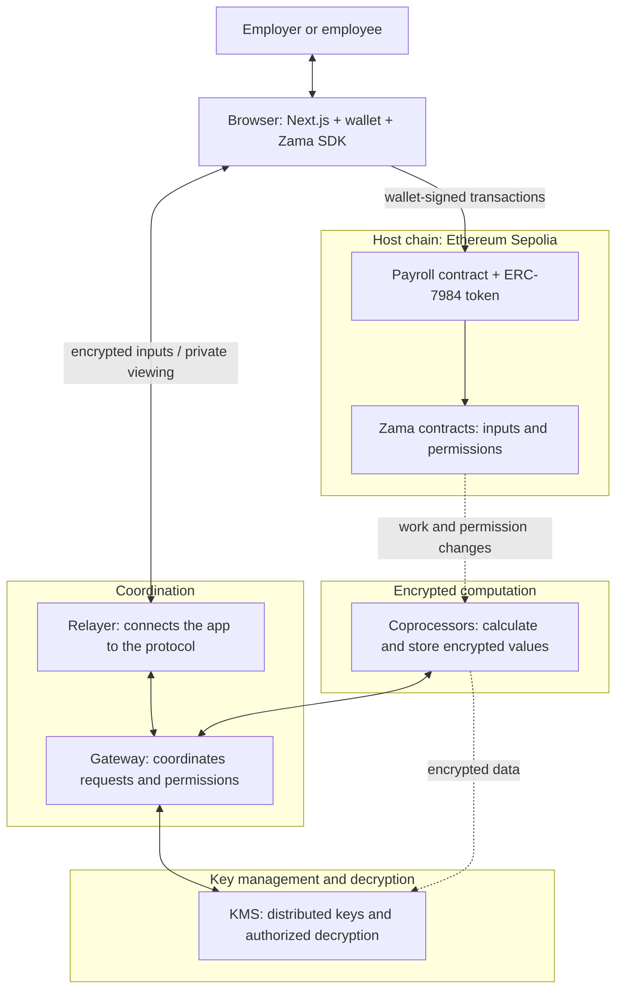

# Zama architecture in one picture

Use this as a three-minute introduction before opening Solidity. Payroll decides who gets paid and who may view a salary. Zama lets the app calculate with encrypted values and reveal results to authorized users.

These arrows show different interactions, rather than one request passing through every component. The browser encrypts inputs and displays authorized results. The Next.js server supplies public deployment addresses and forwards allowed chain reads; it does not receive salary inputs or hold decryption keys.

## The parts students need to know

| Part           | What it does                                                                                         |
| -------------- | ---------------------------------------------------------------------------------------------------- |
| Host chain     | Ethereum runs ordinary contract logic and records requests for encrypted work.                       |
| FHEVM contract | Solidity code uses operations such as `FHE.add` to request calculations on encrypted values.         |
| Handle         | A public reference to an encrypted value. Reading a handle does not reveal its number.               |
| ACL            | The access-control list: permissions that determine who may use or decrypt a value.                  |
| Coprocessors   | Perform the encrypted calculations and keep the encrypted data available.                            |
| Gateway        | Coordinates input verification, permission updates, and decryption requests.                         |
| KMS            | The key management system. Several parties cooperate to enable authorized decryption.                |
| Relayer        | The service the SDK uses to reach protocol features.                                                 |
| SDK and wallet | The SDK encrypts and recovers authorized results; the wallet signs transactions and viewing permits. |

A handle or wallet signature alone does not grant access to a salary. The contract must also give the relevant permission.

## Follow one salary

1. **Encrypt the input.** The employer enters `5000`. The browser converts it into `5_000_000_000` six-decimal token units, then encrypts it for this employer and payroll contract. The SDK returns an encrypted handle and proof. The original number is not sent as public transaction input.
2. **Verify it.** The wallet submits the employee address, handle, and proof. `FHE.fromExternal` checks the encrypted input before the contract uses it.
3. **Calculate.** `FHE.add` adds the encrypted bonus. Coprocessors perform that work. An encrypted comparison and `FHE.select` keep the previous salary if addition overflows.
4. **Save and authorize.** Payroll saves the resulting handle. `FHE.allowThis` lets payroll use it in future transactions. `FHE.allow` lets the employee and employer view it. Each new result needs its own permissions.
5. **View privately.** The employee clicks **View my salary** and signs a viewing permit when prompted. The protocol checks permission; the browser recovers the authorized result. The salary is not published onchain.

Replacing a stored handle does not revoke permanent permissions on earlier handles. Once someone has seen a value, the app cannot make them forget it.

## Payments and public withdrawals

The employer deposits public practice tokens into the official OpenZeppelin wrapper. The wrapper issues confidential ERC-7984 tokens to payroll. Payroll temporarily authorizes the wrapper to use the encrypted payment amount with `FHE.allowTransient`, then pays the employee.

A payroll period records the salary due when payment first starts. A retry pays only what remains; later salary changes do not change that period's amount. A successful transaction can still transfer zero when payroll has insufficient tokens, so the UI privately checks the unpaid amount before reporting completion.

To withdraw public tokens, an employee requests `unwrap`. The wrapper makes the withdrawal amount publicly decryptable. Later, `finalizeUnwrap(requestId, amount, proof)` checks that result and releases public tokens. Keep the request ID while processing finishes. This public exit exposes its amount; salary and bonus never use public decryption.

The employer can privately view payroll's token balance through `treasuryBalance` and `allowTreasuryBalanceViewing`. The second function gives only the employer permission for the current balance handle; it does not move tokens. Deposits and payments create new balance handles, so the frontend checks permission again. Private decryption uses the wrapper's address because the token contract stores that balance. Old granted handles remain authorized; Hide only clears the displayed value.

## Package compatibility

The browser uses `@zama-fhe/sdk` 3.7.1. The [previous Relayer SDK](https://github.com/zama-ai/relayer-sdk) is deprecated and ends maintenance on 6 November 2026; it remains only as a required dependency of Hardhat plugin 0.4.2. OpenZeppelin Confidential Contracts 0.5.3 and that plugin require FHEVM Solidity 0.11.1. Use the lockfile to keep these compatible versions together.

`check:sepolia` compares the installed SDK and Solidity chain settings and checks deployed contracts. Sepolia requires no Zama API key. A future mainnet app would need a protected backend for its Relayer credentials.

## Official references

- [Host chain](https://docs.zama.org/protocol/protocol/overview/hostchain), [coprocessors](https://docs.zama.org/protocol/protocol/overview/coprocessor), [Gateway](https://docs.zama.org/protocol/protocol/overview/gateway), [KMS](https://docs.zama.org/protocol/protocol/overview/kms)
- [Encrypted inputs](https://docs.zama.org/protocol/solidity-guides/smart-contract/inputs), [handles](https://docs.zama.org/protocol/solidity-guides/smart-contract/handles), [permissions](https://docs.zama.org/protocol/solidity-guides/smart-contract/acl), [operations and overflow](https://docs.zama.org/protocol/solidity-guides/smart-contract/operations)
- [SDK setup](https://docs.zama.org/protocol/sdk/guides/configuration), [encryption and private viewing](https://docs.zama.org/protocol/sdk/guides/encrypt-decrypt), [Relayer authentication](https://docs.zama.org/protocol/sdk/guides/authentication)
- [OpenZeppelin wrapper](https://docs.openzeppelin.com/confidential-contracts/api/token), [public decryption](https://docs.zama.org/protocol/solidity-guides/smart-contract/oracle)
